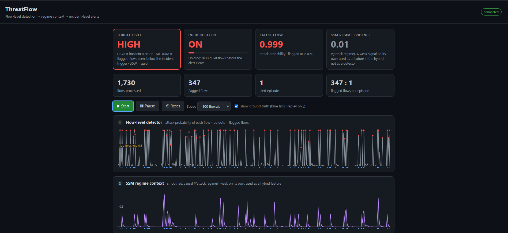
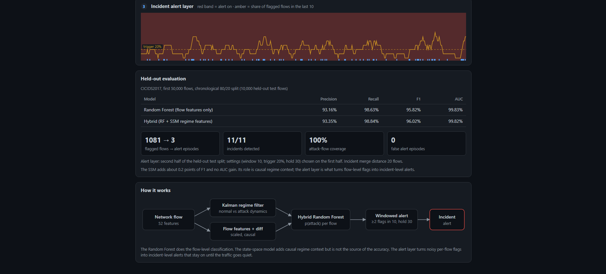

# ThreatFlow
### From Streaming Network Detection to Incident-Level Security Intelligence

<p align="center">
  <strong>Detect suspicious behavior. Understand temporal context. Escalate persistent threats.</strong>
</p>

<p align="center">
  
  
  
  
  
  
</p>

<p align="center">
  <a href="https://threatflow.onrender.com/">Live Demo</a> •
  <a href="https://github.com/PeerAhammad/ThreatFlow">GitHub Repository</a>
</p>

---

## 1. Overview

Modern network intrusion detection systems can generate thousands of individual flow-level predictions. Although these predictions identify potentially malicious activity, they do not necessarily tell security analysts whether suspicious traffic represents a persistent security incident.

**ThreatFlow addresses this operational gap.**

It is a streaming cybersecurity prototype that transforms noisy network-flow detections into a smaller number of persistent, interpretable, incident-level alerts.

The system combines three components:

- **Random Forest:** Detects suspicious network flows using network traffic features.
- **Switching State-Space Model (SSM):** Provides probabilistic temporal regime information and behavioral context.
- **Streaming Alert State Machine:** Aggregates sustained suspicious activity and promotes it into incident-level alerts.

Rather than generating an independent alert for every suspicious flow, ThreatFlow maintains temporal state and requires persistent evidence before escalating activity.

> **Core idea:** A suspicious flow is a detection. Persistent suspicious behavior is a potential incident.

---

## 2. The Problem

Traditional flow-level intrusion detection produces predictions independently.

This creates an operational challenge:

- Large volumes of individual detections.
- Repeated alerts from related network activity.
- Limited temporal context.
- Difficulty distinguishing isolated anomalies from sustained behavioral changes.
- Increased investigation workload for security analysts.

ThreatFlow introduces an additional reasoning layer between detection and incident generation.

```text
        Network Traffic
               |
               v
       Is this flow suspicious?
               |
               v
       Are suspicious flows
       part of sustained activity?
               |
               v
       Is the behavior persistent
       enough to warrant escalation?
               |
               v
        INCIDENT-LEVEL ALERT
```

The objective is not simply to detect more suspicious flows.

It is to make the resulting alerts more operationally meaningful.

---

## 3. System Architecture

ThreatFlow processes network traffic chronologically and combines flow-level predictions with probabilistic temporal context.

```text
                  CICIDS2017 Traffic
                          |
                          v
                Chronological Processing
                          |
                          v
                 Random Forest Detector
                          |
                          v
                  Flow-Level Predictions
                          |
                +---------+---------+
                |                   |
                v                   v
          Suspicious Flows    Switching SSM
                                    |
                                    v
                           Regime Probabilities
                                    |
                                    v
                            Temporal Context
                |                   |
                +---------+---------+
                          |
                          v
                 Streaming Alert State
                      Machine
                          |
                          v
                 Persistence / Hysteresis
                          |
                          v
                  Incident Aggregation
                          |
                          v
                    Incident Alerts
                          |
                          v
                    FastAPI Backend
                          |
                          v
                    Web Dashboard
```

### Core Components

#### 3.1 Flow-Level Detection — Random Forest

A Random Forest classifier operates on network-flow features and produces suspicious/malicious flow predictions.

It serves as the primary detection mechanism.

Held-out evaluation results:

| Model | Precision | Recall | F1 | ROC-AUC |
|:---|---:|---:|---:|---:|
| Random Forest | 93.16% | 98.63% | 95.82% | 99.827% |
| RF + SSM features | 93.35% | 98.84% | 96.02% | 99.823% |

The hybrid configuration improves F1 by approximately **0.20 percentage points**, while ROC-AUC remains effectively unchanged.

ThreatFlow therefore does not claim that the SSM produces a substantial improvement in the underlying classification performance.

Its primary contribution lies in temporal context and incident-level alert aggregation.

#### 3.2 Temporal Regime Modeling — Switching SSM

The Switching State-Space Model provides probabilistic information about changing network traffic behavior.

It contributes:

- Current behavioral regime.
- Regime probabilities.
- Temporal transitions.
- Persistence of changing network behavior.
- Additional context for interpreting suspicious activity.

The SSM is used as a temporal modeling component rather than a replacement for the Random Forest detector.

#### 3.3 Streaming Incident-Level Alerting

This is the central operational component of ThreatFlow.

Instead of immediately generating an alert for every suspicious flow, the streaming alert state machine maintains state across incoming observations.

It uses persistence-based conditions and hysteresis to determine when suspicious activity should be promoted into an incident-level alert.

**Current configuration:**

| Parameter | Configuration |
|:---|---:|
| Observation window | 10 flows |
| Trigger threshold | 20% |
| Hold | 30 |
| Alert-setting selection | First half of held-out split |
| Final evaluation | Second half of held-out split |

This reduces alert fragmentation and allows related suspicious activity to be represented through fewer, more meaningful alert episodes.

---

## 4. Evaluation Results

ThreatFlow was evaluated using a chronological subset of CICIDS2017 traffic.

### 4.1 Classification Performance

| Metric | Random Forest | RF + SSM Features |
|:---|---:|---:|
| Precision | 93.16% | 93.35% |
| Recall | 98.63% | 98.84% |
| F1-score | 95.82% | 96.02% |
| ROC-AUC | 99.827% | 99.823% |

The classification results establish the baseline detection capability and show the relatively modest contribution of the hybrid configuration.

### 4.2 Incident-Level Streaming Evaluation

The streaming evaluation produced:

| Metric | Result |
|:---|---:|
| Incidents detected | **11 / 11** |
| Incident coverage | **100%** |
| Alert episodes | **3** |
| False episodes | **0** |
| Flagged flows | **1,081** |

### 4.3 From Individual Detections to Incidents

The operational transformation is the most important result:

```text
       1,081 Flow-Level Flags
                 |
                 v
         Temporal Aggregation
                 |
                 v
          Persistence Logic
                 |
                 v
           3 Alert Episodes
                 |
                 v
       11 / 11 Incidents Covered
```

Rather than treating 1,081 flagged flows as 1,081 independent alerts, ThreatFlow aggregates sustained evidence into three alert episodes.

This demonstrates the potential value of temporal reasoning and persistence-based alerting for reducing fragmented security notifications.

**The primary contribution is operational alert aggregation, not a dramatic increase in classification accuracy.**

---

## 5. Dashboard

ThreatFlow includes a web dashboard for monitoring the streaming detection pipeline.

It provides visibility into:

- Network detection activity.
- Suspicious flow predictions.
- Temporal regime information.
- Regime probabilities and transitions.
- Streaming alert states.
- Incident-level alert episodes.
- Operational metrics.

### Dashboard Overview



### Incident Alert Monitoring



---

## 6. Evaluation Methodology

### Dataset

The evaluation uses the CICIDS2017 intrusion detection dataset.

The first **50,000 network flows** are used for the reported evaluation.

### Chronological Split

The traffic is processed chronologically using an 80/20 split.

```text
             50,000 Flows
                   |
          +--------+--------+
          |                 |
          v                 v
      40,000             10,000
      Training           Held-out Test
```

### Alert Evaluation Strategy

The held-out portion is further separated into two chronological segments.

```text
             Held-out Test
                   |
          +--------+--------+
          |                 |
          v                 v
       First Half       Second Half
          |                 |
          v                 v
     Alert-setting      Final Streaming
      Selection          Evaluation
```

The first half is used for alert-setting selection, while the second half is reserved for final evaluation.

This separates the alert-setting stage from the final reported evaluation segment and reduces direct tuning on the final portion.

The resulting evaluation artifact is stored at:

`artifacts/eval_summary.json`

---

## 7. Technology Stack

| Component | Technology |
|:---|:---|
| Programming Language | Python |
| Machine Learning | Scikit-learn |
| Flow-Level Detection | Random Forest |
| Temporal Modeling | Switching State-Space Model |
| Backend | FastAPI |
| Real-Time Communication | WebSockets |
| Frontend | HTML, CSS, JavaScript |
| Dataset | CICIDS2017 |
| Model Serialization | Joblib |
| Testing | Pytest |
| Deployment | Render |

---

## 8. Project Structure

```text
ThreatFlow/
│
├── model/
│   ├── alerts.py
│   ├── inference.py
│   ├── switching_ssm.py
│   └── __init__.py
│
├── backend/
│   ├── main.py
│   └── __init__.py
│
├── frontend/
│   ├── index.html
│   └── static/
│       ├── app.js
│       └── style.css
│
├── lab/
│   └── Local VAPT training lab
│
├── threatflow_local_vapt_lab/
│   └── Local lab support files
│
├── vapt/
│   └── VAPT assessment components
│
├── tests/
│   └── test_streaming.py
│
├── data/
│   └── replay_sample.npz
│
├── artifacts/
│   ├── eval_summary.json
│   └── pard_model.joblib
│
├── docs/
│   ├── threatflow-dashboard-overview.png
│   └── threatflow-dashboard-alerts.png
│
├── train.py
├── evaluate.py
├── diagnose.py
├── make_replay.py
├── requirements.txt
├── README.md
└── .gitignore
```

The full CICIDS2017 dataset is intentionally excluded because of its size.

A smaller replay artifact is included to demonstrate the streaming pipeline without requiring the complete dataset.

---

## 9. Getting Started

### Prerequisites

- Python 3.10 or newer.
- Git.
- pip.

### Step 1 — Clone the Repository

```bash
git clone https://github.com/PeerAhammad/ThreatFlow.git

cd ThreatFlow
```

### Step 2 — Create a Virtual Environment

Windows:

```powershell
python -m venv .venv

.venv\Scripts\Activate.ps1
```

Linux/macOS:

```bash
python -m venv .venv

source .venv/bin/activate
```

### Step 3 — Install Dependencies

```bash
pip install -r requirements.txt
```

### Step 4 — Start the Backend

```bash
uvicorn backend.main:app --reload
```

The application will be available at:

| Service | URL |
|:---|:---|
| Dashboard | http://127.0.0.1:8000/ |
| API | http://127.0.0.1:8000 |
| API Documentation | http://127.0.0.1:8000/docs |

---

## 10. Local VAPT Training Lab

ThreatFlow also includes an experimental, isolated VAPT assessment workflow for testing assessment requests and target-scope enforcement.

The local training lab provides a controlled environment for validating:

- Registered target scope.
- Host and port restrictions.
- Assessment request validation.
- Unauthorized target rejection.
- Assessment workflow behavior.

### Start the Local Lab

From the repository root:

```powershell
python -m uvicorn lab.app:app --host 127.0.0.1 --port 8765
```

The lab is configured to run locally:

```text
http://127.0.0.1:8765
```

The current registered training scope is:

```text
Host: 127.0.0.1
Port: 8765
Active validation: Disabled
```

**Safety boundary:** The local training lab is separate from the main Render deployment. It is intended for controlled local testing and should not be exposed publicly or used to assess systems without authorization.

---

## 11. Live Deployment

The main ThreatFlow application is deployed using Render.

**Live Application:**

https://threatflow.onrender.com/

The deployment uses:

**Build Command**

```bash
pip install -r requirements.txt
```

**Start Command**

```bash
uvicorn backend.main:app --host 0.0.0.0 --port $PORT
```

The hosted application provides access to the deployed dashboard and backend.

The local VAPT training lab is not automatically deployed as part of this service.

---

## 12. Running Tests

Run the test suite:

```bash
python -m pytest -q
```

Current reported test status:

```text
3 passed
```

The tests cover streaming alert behavior and relevant state transitions.

---

## 13. Reproducibility

The repository includes the primary artifacts required to inspect and reproduce the prototype:

- Trained Random Forest model.
- Evaluation summary.
- Replay data.
- Training script.
- Evaluation script.
- Diagnostic utilities.
- Streaming alert implementation.
- Test suite.
- Web dashboard.

Large raw datasets and local runtime logs are excluded through `.gitignore`.

---

## 14. Limitations and Future Work

ThreatFlow is a cybersecurity research and hackathon prototype, not a production-grade network security platform.

Current limitations include:

- Evaluation is performed on a subset of CICIDS2017.
- The Random Forest remains the primary flow-level detector.
- The SSM provides temporal regime context rather than a substantial standalone classification improvement.
- Alert thresholds are manually configured and tuned.
- The current replay mechanism demonstrates streaming behavior but is not equivalent to deployment on a live network.
- Evaluation on additional datasets and real network traffic is required.
- Production deployment would require additional security hardening, monitoring, and validation.

### Potential Future Improvements

- Evaluation across additional intrusion detection datasets.
- Adaptive alert thresholds.
- More sophisticated incident correlation.
- Extended temporal regime analysis.
- Live network traffic ingestion.
- Improved incident investigation and reporting.
- Expanded VAPT assessment capabilities.

---

## 15. Key Takeaway

ThreatFlow explores an important operational distinction in cybersecurity:

**Detecting suspicious traffic is not the same as identifying a security incident.**

By combining flow-level classification, probabilistic temporal context, and persistence-based alert aggregation, ThreatFlow demonstrates how noisy network detections can be transformed into a smaller number of meaningful security alerts.

```text
       FLOW-LEVEL DETECTION
                 |
                 v
       TEMPORAL REGIME CONTEXT
                 |
                 v
       PERSISTENCE / HYSTERESIS
                 |
                 v
        INCIDENT-LEVEL ALERT
```

The goal is not to generate more alerts.

It is to generate alerts that matter.

---

<p align="center">
  <strong>ThreatFlow — From Network Detections to Actionable Security Intelligence.</strong>
</p>

<p align="center">
  Built by <a href="https://github.com/PeerAhammad">Peer Ahammad M. Bagawan</a>
</p>